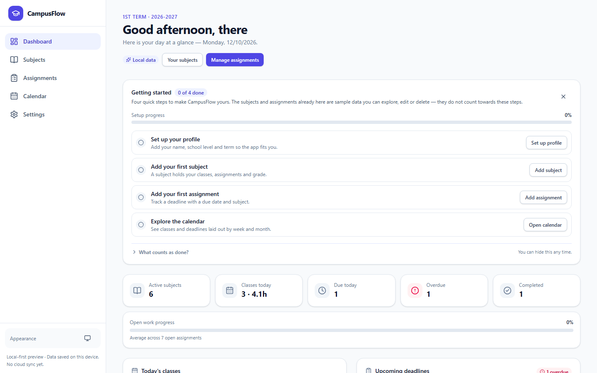
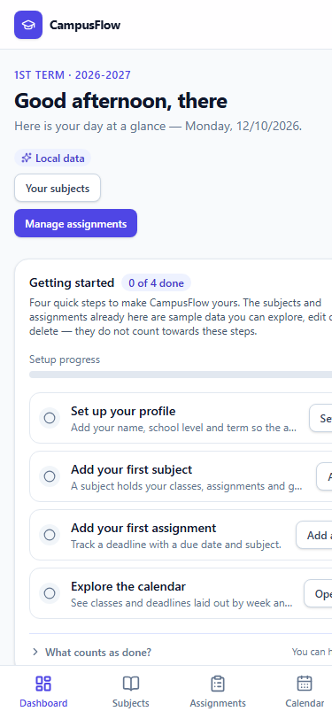
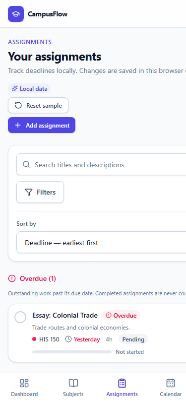
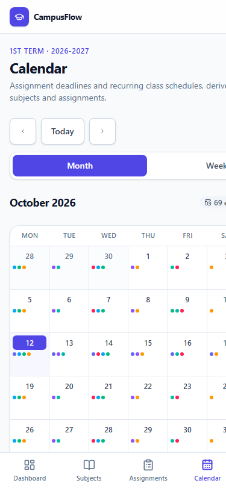

# CampusFlow

A mobile-first academic productivity platform for university, college and high school
students. CampusFlow brings class schedules, assignment deadlines, subjects and
progress tracking into one place, with light and dark themes and full offline
support.

> **Project status: local-first preview — no backend.** Assignments, subjects and
> your profile are stored in this browser only. **There is no AI, no account system
> and no cloud sync** — the Settings page lists planned features as "Not available
> yet" so nothing implies a capability that does not exist.

## Implemented features

- **Dashboard** — personalised greeting, day summary tiles, today's classes, upcoming
  deadlines, subject overview, quick actions, and a "Getting started" guide that tracks
  real setup progress (never counting seeded sample records).
- **Assignment management** — create, edit, complete and delete assignments with
  search and filters (subject, status, priority, deadline window), four sort orders
  with deterministic tie-breaking, and progress tracking from 0–100%.
- **Subject management** — create, edit, archive, restore and delete subjects with
  code, name, instructor, colour, credits, classroom and a weekly schedule.
- **Weekly calendar** — month and week views generated from subject schedules and
  assignment deadlines, with today highlighted and dates in your chosen format.
- **Student profile** — display name, school level, optional school name, academic
  year, term/semester and preferred date format.
- **Themes** — light, dark, or follow-system, persisted locally.
- **Responsive shell** — sidebar navigation on desktop, bottom tab bar plus top bar on
  mobile, a keyboard-accessible skip link, and a shared dialog primitive with focus
  trapping, restoration and scroll locking.
- **Honest persistence** — failed writes are surfaced instead of reporting a false
  success, and unreadable stored data is preserved rather than silently replaced.

## Technology stack

| Concern | Choice |
| --- | --- |
| Framework | React 19 + TypeScript (strict) |
| Build tool | Vite 8 |
| Styling | Tailwind CSS v4 |
| Routing | React Router 7 |
| Icons | Lucide React (explicit tree-shakeable registry) |
| Linting | ESLint (flat config) |
| Formatting | Prettier |
| Testing | Vitest + React Testing Library + jsdom |

## Requirements

- Node.js 20.19+ or 22.12+ (Node 24 recommended — Vite 8 requires it)
- npm 10+

## Installation

```bash
git clone https://github.com/YOUR-USERNAME/campusflow.git
cd campusflow
npm install
```

No environment variables or configuration files are required to run the app.

## Development

```bash
npm run dev
```

The dev server prints its local URL (default <http://localhost:5173>).

## Commands

| Command | What it does |
| --- | --- |
| `npm run dev` | Start the Vite dev server with HMR |
| `npm run build` | Typecheck and produce a production build in `dist/` |
| `npm run preview` | Serve the production build locally |
| `npm run lint` | Run ESLint across the project |
| `npm run typecheck` | Typecheck with `tsc --noEmit` |
| `npm run test` | Run Vitest in watch mode |
| `npm run test -- --run` | Run the test suite once |

## Testing

```bash
npm run test -- --run
```

Areas covered include date arithmetic and timezone safety, grade calculation edge
cases, profile normalization and persistence, subject CRUD and archive behaviour,
referential integrity on subject deletion and sample reset, assignment filtering and
sorting, the assignments store, calendar event generation, accessibility (skip link,
focus management, labelled controls, contrast), and dashboard and settings behaviour
including dialogs and validation.

## Verification status

Executed against this workspace (Node 24, npm 11) before the current commit:

| Check | Result |
| --- | --- |
| `npm run lint` | Pass — 0 problems (errors or warnings) |
| `npm run typecheck` | Pass — no errors |
| `npm run test -- --run` | Pass — 428 tests / 17 files |
| `npm run build` | Pass — 394.23 kB JS / 117.64 kB gzip, 47.09 kB CSS |

## Screenshots



| Dashboard — mobile | Assignments — mobile | Calendar — mobile |
| --- | --- | --- |
|  |  |  |

The screenshots above show the **light theme** with the built-in demonstration
data. CampusFlow also ships a full **dark theme**, selected from the theme
toggle in the header or from Settings → Appearance. No dark-theme screenshots
are included, so the appearance is best judged live.

## Data storage and privacy

CampusFlow is **local-first**. There is no server, no analytics and no account.

| Dataset | localStorage key |
| --- | --- |
| Student profile | `campusflow.profile.v1` |
| Subjects | `campusflow.subjects.v1` |
| Assignments | `campusflow.assignments.v1` |
| Theme | `campusflow.theme.v1` |
| Onboarding state | `campusflow.onboarding.v1` |

Practical implications:

- Data lives in one browser on one device. Clearing browser data deletes it.
- Nothing is transmitted anywhere, and there is nothing to sign in to.
- The app ships with six sample subjects and eight sample assignments so a new
  student can explore immediately. Sample records are labelled in the UI and never
  count as setup progress.
- Stored data is normalized on read, so a partially written or hand-edited record
  cannot break the interface. JSON that cannot be parsed is left untouched rather
  than being silently overwritten.
- If the browser refuses to write (private mode, storage full), the app says so
  rather than reporting a save that did not happen.

## Project structure

```
src/
├── components/
│   ├── layout/            # AppLayout, Sidebar, MobileNav
│   └── ui/                # Button, ButtonLink, Card, Badge, Field, Modal,
│                          # EmptyState, LoadingState, ThemeToggle, PageHeader,
│                          # GradeRing, SubjectChip, ProgressBar, Icon
├── features/
│   ├── assignments/       # store, AssignmentCard, AssignmentList, AssignmentForm
│   ├── calendar/          # month and week views
│   ├── dashboard/         # dashboard page and sections
│   ├── profile/           # profile form
│   ├── settings/          # theme, profile, local data, planned features
│   └── subjects/          # store, SubjectCard, SubjectForm, page
├── hooks/                 # useLocalStorage, useTheme, useProfile, useOnboarding
├── lib/                   # constants, date, subjects, profile, grade, calendar
│                          # events, assignment filters, mockData, utilities
├── types/                 # shared types
└── test/                  # Vitest setup and specs
```

Data flow is one-directional. Each store owns a localStorage key and exposes
derived selectors; pages read from the store; `lib/` holds pure, independently
tested functions.

## Roadmap

Not yet implemented, and not faked in the UI:

- **Grade calculator** — weighted categories and grade-goal projections.
- **AI academic planning** and assignment assistance for multiple-choice,
  enumeration, essay and other formats, behind a provider-independent interface.
- **Document handling** — PDF, DOCX and image upload, AI-assisted editing and DOCX
  export.
- **Accounts, cloud sync and offline-first caching.**

## Accessibility

Keyboard-operable navigation and controls, visible focus indicators, skip link,
labelled form controls, validation messages tied to their fields via
`aria-describedby`, dialogs that trap focus and restore it on close, live regions for
status announcements, colour contrast meeting WCAG AA for body text, and support for
`prefers-reduced-motion`.

## Contributing conventions

See [AGENTS.md](./AGENTS.md) for architecture rules, coding conventions, commands and
the implementation boundaries for the current phase.

## License

Released under the [MIT License](./LICENSE).
